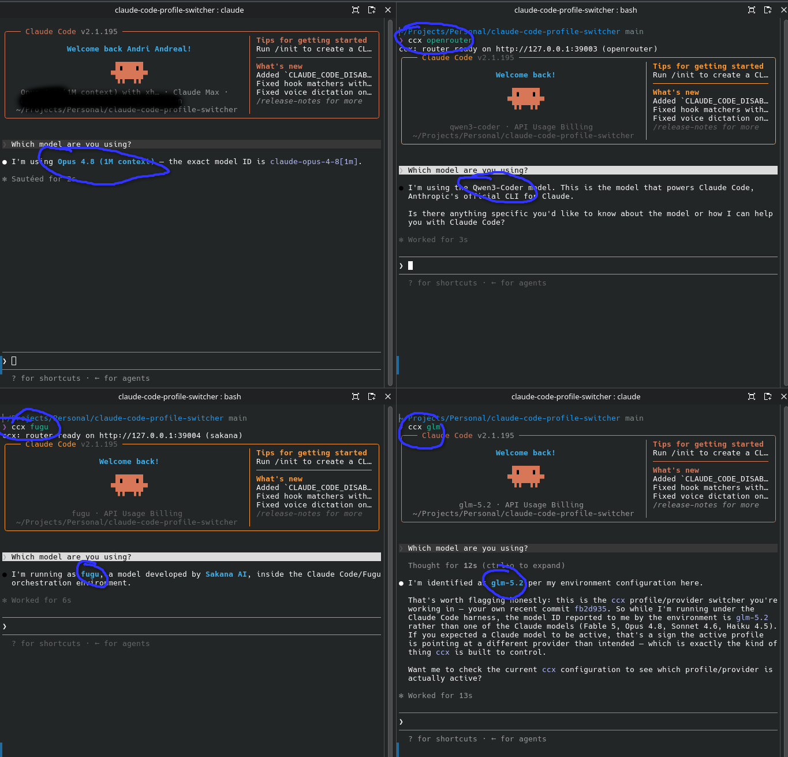

# ccx - Claude Code and Codex profile/provider switcher

`ccx` launches Claude Code, Codex, Kimi Code or MiniMax Code through named profiles. Use your existing
CLI login, select another provider/model, or save a workflow that plans, builds,
tests and checks changes until the builder and checker agree.

Claude Code profiles support Anthropic-compatible providers and OpenAI-compatible
backends through the bundled Rust translator, `ccx-router`. Native Codex profiles
run Codex CLI directly with its own authentication and configuration. Third-party
Claude profiles are isolated by default; native Claude and Codex profiles reuse
their existing login unless you request isolation. Neither CLI is patched.

[Quick start](#quick-start) · [OAuth login](#login-and-default-cli-settings) ·
[Workflows](#create-a-workflow-once-launch-by-name) · [CLI options](#cli-reference) ·
[CachyOS / Arch](#cachyos--arch-linux) · [Desktop GUI](gui/README.md)



*One question, four providers: `ccx claude` (Opus 4.8), `ccx openrouter` (Qwen3-Coder),
`ccx fugu` (Sakana Fugu), and `ccx glm` (GLM-5.2), the same Claude Code, a different model
behind each.*

## Features

- **Named profiles** - one command per provider/model combo: `ccx glm`, `ccx claude`, …
- **Isolated credentials** - third-party profiles each get their own `CLAUDE_CONFIG_DIR`,
  so logins and history never bleed into your Anthropic account.
- **No patching** - Claude Code runs unmodified; everything is driven by env vars.
- **Editable provider defaults** - endpoints and model IDs live in simple template files.
- **Live model discovery** - the `ccx new` wizard fetches each provider's model list
  from its API (`/v1/models`) and offers a type-to-filter picker; falls back to typing.
- **Compatibility checks** - `ccx doctor` validates a profile without spending tokens;
  opt-in `ccx certify` verifies basic responses, streaming, and tool calls.
- **Resilient local router** - ordered fallbacks, bounded retries/timeouts, stream
  keepalives, request IDs, and secret-safe JSON event logs.
- **Verified prebuilt router releases** - the release workflow builds Linux, macOS,
  and Windows binaries with SHA-256 manifests and GitHub provenance attestations.
- **CLI + desktop GUI** - manage profiles from the terminal or a [Tauri](https://tauri.app) app.
- **Native Codex profiles** - use Codex CLI with its own ChatGPT login and optional isolated home.
- **Saved workflows** - configure planner, builder, reviewer and verification once in `ccx new`, then launch by name.
- **Interactive clarification** - when a request is ambiguous, the orchestrator asks up to
  three questions with concrete options; the team shows them as a picker and the answers
  travel with the plan instead of becoming another guess.
- **Verification command picker** - if no test/build command is detected, the team offers
  the detected command plus the ones that fit the checkout, instead of an empty text prompt.
- **Interactive team TUI** - a composer with live `/command` and `@file` suggestions,
  arrow-key pickers for every choice, a scrollable conversation, and results rendered
  as Markdown with aligned tables.
- **Codex in any checkout** - Codex refuses to start outside a trusted git repository, so
  ccx registers the project and skips that check; planning works in a plain folder too.
- **Builder/checker consensus** - exchange fixes and evidence, rerun verification,
  and require both `READY` and `APPROVED` on the same code before completion.
- **Bounded retries and records** - configure revision budgets/timeouts, preserve
  failure diagnostics, and bind approvals to plan and code fingerprints.

## Supported providers

**Anthropic-compatible** (direct, no router): `claude` (Anthropic) · `minimax` · `glm` · `deepseek` · `kimi` · `custom`

**OpenAI-compatible** (via `ccx-router`, a small translator `ccx` installs and runs
for you): `openai` · `openrouter` · `ollama` · `vllm` · `lmstudio` · `sakana` · `custom-oai`.
See [OpenAI-compatible providers](#openai-compatible-providers-via-a-local-router).

**Native CLI:** `codex` uses Codex CLI with ChatGPT OAuth or its configured login.
`kimi-cli` launches the separately installed Kimi Code CLI, and `mcode` launches
MiniMax Code. These names are distinct from the existing `kimi` and `minimax`
providers, which use Claude Code. Create and launch native profiles with:

```bash
ccx new --name kimi-native --provider kimi-cli --yes
ccx new --name minimax-native --provider mcode --yes
ccx kimi-native login
ccx minimax-native login --region global
ccx kimi-native
ccx minimax-native
```

In a terminal, `ccx new` opens a provider picker that lists every bundled
template in the same three groups, with the default model or endpoint as a
dim subtitle: Anthropic-compatible, OpenAI-compatible (via `ccx-router`), and
Native CLI. "Custom / type manually" accepts a provider name of your own, and
your own templates in `$CCX_HOME/providers` join the list. The menu scrolls and
reports its position when it is taller than the terminal.

Install and authenticate each CLI separately. Set `CCX_KIMI_BIN` or
`CCX_MCODE_BIN` to override its executable. The optional `--model` saves a native
model default. Native Kimi and mcode profiles can also be selected as workflow roles. On Linux,
these roles require `bwrap` (Bubblewrap); their CLI data directories must be outside
the project. Planning and review run with a read-only project, and the builder may
write to it. Kimi uses its default effort; mcode supports its own effort values.
CLI data/session directories remain writable. Kimi uses JSON responses requested
in the prompt, which CCX validates; an invalid response stops the workflow.
Native Kimi and mcode profiles do not yet support `--isolate`.

| Profile provider/type | Executable | Authentication/configuration |
| --- | --- | --- |
| `claude` | `claude` | Existing Claude Code login; `opusplan` is the bundled model default |
| `minimax`, `glm`, `deepseek`, `kimi`, `custom` | `claude` | Provider endpoint/key; isolated Claude home by default |
| `openai`, `openrouter`, `ollama`, `vllm`, `lmstudio`, `sakana`, `custom-oai` | `claude` + `ccx-router` | Upstream API key or local server; isolated Claude home by default |
| `codex` | `codex` | Existing Codex login/configuration, or a separate home with `--isolate` |
| Loop workflow | CLI belonging to each selected profile | Each role uses that profile's configuration |

Names are chosen by you: `ccx work` can launch Codex if `work` was created with
`--provider codex`. The provider/type determines the executable. In particular,
the `openai` provider runs Claude Code through the router, while `codex` runs
Codex CLI directly.

## Prerequisites

- [Claude Code](https://docs.anthropic.com/en/docs/claude-code) installed and on your `PATH` for Claude/provider profiles.
  `ccx` runs the `claude` binary (override with `CCX_CLAUDE_BIN`).
- Codex CLI on your `PATH` for native Codex profiles (override with `CCX_CODEX_BIN`).
- Python 3.10+ for saved workflows; install each CLI used by the selected roles.
- Bash (the `ccx` CLI is a Bash script).
- `curl` or `wget` for the verified router download. `curl` is also used by
  network diagnostics and certification.
- Python 3 or Node.js for strict JSON/SSE validation during active certification.
- Rust + cargo are only needed when a matching prebuilt router is unavailable or
  when building from source. Override the router with `CCX_ROUTER_BIN` if needed.
- For building the desktop GUI from source: Rust + cargo and Node + npm (see
  [`gui/README.md`](gui/README.md)). Release bundles do not require a development toolchain.
- Linux or macOS for the Bash CLI and Unix workflow locking.

### Installing Rust

If you don't have Rust installed, use [rustup](https://rustup.rs) (the official installer):

```bash
curl --proto '=https' --tlsv1.2 -sSf https://sh.rustup.rs | sh
```

Follow the on-screen prompts (the defaults are fine), then reload your shell:

```bash
source "$HOME/.cargo/env"
```

Verify the installation:

```bash
rustc --version
cargo --version
```

> **Note:** the installer first tries the matching published, checksum-verified
> `ccx-router` release. Rust is only the fallback for an unsupported platform,
> an unavailable release, `CCX_ROUTER_INSTALL=build`, or source development.

## Install

```bash
./install.sh
# add ~/.local/bin to PATH if prompted
```

Router install policy can be selected with `CCX_ROUTER_INSTALL=auto|download|build|skip`.
`auto` (the default) downloads a verified binary and falls back to a local Rust build.
Use `download` when the absence of a verified prebuilt must be a hard failure, or
`skip` when only direct Anthropic-compatible profiles are needed.
Run this from your checkout. The installer links `~/.local/bin/ccx` to this
repository, copies the bundled provider templates, and installs `ccx-router`
according to the selected policy. Keep the checkout at this location. Existing profile
files are retained; reinstalling refreshes bundled template files, including any
edits you made to those templates. Custom-named templates are retained.

The installer installs the CLI/router. Build and install the GUI separately using
the [desktop instructions](gui/README.md#build-and-install-on-linux).

### CachyOS / Arch Linux

For a source build of the CLI, router and GUI, install the build tools and Linux
libraries if they are missing:

```bash
sudo pacman -Syu
sudo pacman -S --needed base-devel rustup nodejs npm python pkgconf \
  webkit2gtk-4.1 gtk3 libsoup3 openssl
# Only if rustup has no toolchain configured:
rustup default stable
```

If you already have a working Rust/Cargo toolchain, keep it rather than adding a
second Rust installation. Claude Code and Codex CLI are installed and
authenticated separately. Check the required engines with `claude --version`
and `codex --version`.

```bash
./install.sh
cd gui
npm ci
npm run tauri build -- --no-bundle
```

The binary is `gui/target/release/ccx-gui` relative to the repository root.
See [GUI installation](gui/README.md#build-and-install-on-linux) for the user-local
launcher and desktop-menu entry. More Linux package details are in the
[Tauri prerequisites](https://v2.tauri.app/start/prerequisites/#linux).

### Quick start

Run `ccx new` in a terminal. Select **Single model** to create a CLI profile,
or **Plan/build/review loop** to create a team. Use **↑/↓ and Enter** to
choose and **q** to cancel. The Single menu offers Claude Code, Codex, Kimi
Code and MiniMax Code.

Or create native profiles with flags:

```bash
ccx new --name claude --provider claude --yes
ccx new --name codex --provider codex --yes
ccx claude
ccx codex
```

Skip creation for names you already have. These native profiles reuse the login
of their respective CLI by default. Follow the login section if you need to sign in.

## Use

```bash
ccx new                      # create a single CLI profile or team
ccx --version                # print ccx, ccx-router, Claude Code and Codex versions
ccx list                     # list profiles  (alias: ls)
ccx doctor work              # configuration + authenticated reachability checks
ccx doctor work --no-network # local checks only; never contacts the provider
ccx certify work             # opt-in basic/streaming/tool probes (up to 3 requests)
ccx claude                   # Anthropic login; Opus plans, Sonnet executes (opusplan)
ccx claude --model haiku     # extra args are passed straight to claude
ccx ollama -p "hello"        # run an OpenAI-compatible profile through ccx-router
ccx logs ollama              # last 100 secret-safe router events
ccx show <name>              # inspect a profile (token masked)
ccx edit <name>              # edit in $EDITOR
ccx rm <name>                # remove a profile  (aliases: remove, delete)
ccx codex exec "Explain this repository" # native Codex non-interactive execution
ccx show work                # inspect a profile named work (token masked)
ccx edit work                # edit work in $EDITOR
ccx rm unused-profile        # remove a profile (aliases: remove, delete)
```

The interactive secret prompts are hidden. For automation, prefer stdin so keys
do not enter shell history or the process list:

```bash
printf '%s\n' "$API_KEY" | \
  ccx new --name work --provider minimax --model MiniMax-M3 --token-stdin --yes
```

`--upstream-key-stdin` and repeatable `--fallback-key-stdin` follow the same rule.
The older value-taking flags remain compatible, but expose their value to normal
command-line inspection while the process is running.

## How it works

- Profiles live in `~/.config/ccx/profiles/<name>/profile.env` (`chmod 600`).
- Third-party profiles are isolated: each gets its own `CLAUDE_CONFIG_DIR`
  (`~/.config/ccx/profiles/<name>/home`), so credentials and history never mix.
- The `claude` profile uses your normal Anthropic login and `~/.claude`
  (plugins/skills intact) and defaults to `ANTHROPIC_MODEL=opusplan`.
- Provider defaults are in `~/.config/ccx/providers/*.tmpl`. Edit them to update
  endpoints or model IDs (these can change over time).
- Router events are written to `~/.config/ccx/profiles/<name>/router.log`
  (`chmod 600`) and can be read with `ccx logs <name> [--follow]`.

## Login and default CLI settings

CCX delegates login and credential refresh to the official CLIs. Existing login,
settings and history are reused when the profile has isolation disabled. Profile
model/endpoint overrides apply to the invocation; CCX does not rewrite the global
CLI configuration.

| Engine | Sign in | Check login | Sign out |
| --- | --- | --- | --- |
| Claude Code | `ccx claude auth login` | `ccx claude auth status` | `ccx claude auth logout` |
| Codex CLI | `ccx codex login` | `ccx codex login status` | `ccx codex logout` |

The examples assume profiles named `claude` and `codex`. Native Claude uses its
configured authentication; run `auth login` and select the account/login method
appropriate for your subscription. See [Claude Code authentication](https://code.claude.com/docs/en/authentication).

The bundled Claude profile sets `ANTHROPIC_MODEL=opusplan`; it therefore reuses
your login/settings while overriding the model. Use `ccx claude --model <model>`
or edit the profile to change that default. Codex uses its configured model when
no `--model` was saved in the profile.

To isolate another account, create a profile with `--isolate` and authenticate
through that profile. Claude uses a profile-specific `CLAUDE_CONFIG_DIR`; Codex
uses a profile-specific `CODEX_HOME`. Existing externally configured home
variables are respected for nonisolated profiles. `ccx new --login` and
`--device-auth` are Codex-only options; Claude authentication is invoked after
profile creation through `ccx <profile> auth login`.

### Codex with ChatGPT login

Choose `codex` in `ccx new`, or create a profile and sign in in one command:

```bash
ccx new --name codex --provider codex --login --yes
ccx codex
ccx codex exec "Explain this repository"
ccx codex login status
```

For a remote/headless machine, use `--device-auth` instead of `--login`.
You complete authentication in your browser; Codex CLI handles OAuth, credential
storage and token refresh. CCX does not copy or parse OAuth tokens. See the
[official authentication documentation](https://learn.chatgpt.com/docs/auth).

Native profiles reuse your existing Codex configuration and login by default.
Add `--isolate` when creating one to use a separate `CODEX_HOME` at
`~/.config/ccx/profiles/<name>/home`; sign in separately for that home. Use
`ccx <name> login`, `login --device-auth`, `login status`, or `logout` as needed.
An existing API-key login remains an API-key login until you explicitly switch
it using Codex's login flow. CCX does not change your global authentication.

`--model` on creation saves an optional default, while invocation arguments can
override it. An empty model uses Codex's own configuration. The existing `openai`
provider continues to run Claude Code through the API router; `codex` runs the
native CLI directly. Native profiles are available in the desktop GUI as well.

## Create a workflow once, launch by name

Teams can use an **orchestrator** profile alongside planner, builder and reviewer.
The orchestrator selects `inspect` for explicitly read-only requests, `direct` for
small unambiguous edits, or `plan` for complex or uncertain tasks. Inspect returns
a report without changing the checkout. Direct skips planning but still runs
verification and review. You can override the decision for one run:

```bash
ccx team --route inspect "Explain the authentication flow"
ccx team --route direct "Fix the typo in README.md"
ccx team --route plan "Add CSV export"
```

In an interactive session, existing three-role workflows use their planner profile
as orchestrator unless one is configured; non-interactive legacy runs keep their
previous plan-first behavior. The borrowed orchestrator is labelled `(auto)` in the
team TUI so it is clear it was not configured by the profile. To create a
four-role workflow non-interactively, add `--orchestrator <profile>` when using
`ccx new --type loop`; `--orchestrator-model` and `--orchestrator-effort` are optional.
Interactive creation asks for the orchestrator before the other three roles.
A plan or direct route requires a verification command; the team TUI asks for one
in place when detection finds nothing. `--review-only` always plans and reviews
without building.

In an interactive terminal, the team renders a two-column view: a borderless
conversation on the left and a live agent rail on the right. The header carries the
active route, the project path and the current Git branch. Each agent shows a status
glyph plus its word (`● running`, `✓ done`, `✗ failed`, `○ waiting`), so state never
depends on colour alone. The current task is pinned at the top of the conversation and
the active agent's elapsed time runs in the status row. Your own messages carry a
full-width highlight, so they stand apart from agent output. Agent replies are laid out
as Markdown in the conversation, and each run of tool calls folds into one summary
(`⏺ 6 tool calls · read 3 · grep 2 · bash 1`) with the latest call beneath it; Ctrl+O
expands every call and folds them again. Heartbeats stay in the status row instead of
the conversation. When the rail has room, a **FLOW** panel at its bottom draws the four
agents as boxes coloured by status; each hand-off of this task (orchestrator to planner,
planner to reviewer, reviewer back to the planner or builder) appears as a line, and a
dot travels along the live one while the receiving agent works. The conversation scrolls with the mouse wheel and PgUp/PgDn at any
time, with ↑/↓ while an agent runs, and with Home/End while the input line is empty; it
holds its place as new output arrives, and End (or scrolling to the bottom) follows
again. The team asks the terminal for mouse reports so the wheel scrolls instead of
recalling input; select text with Shift+drag, or set `CCX_MOUSE=0` to leave the mouse
to the terminal (the wheel then acts as ↑/↓). The layout redraws when the terminal is resized.

Token use is read from each CLI's own stream and split into input and output. Input
counts every prompt token, with the cached part shown separately, because Claude
reports most of a prompt as cache reads. Each agent in the rail shows
`tokens: in 154.2k (cache 4.0M) · out 45.3k`; the status row carries the running total
for the task and the completion line ends with it. Claude reports per message, so its
figure moves while it works; Codex and minimax report once, when the agent finishes.
Cost (`· $0.0049`) is shown only for native Claude profiles, because profiles routed to
other models report Anthropic prices. Each run keeps per-phase and total counts in
`usage.json`; `/history` shows them for a run, and non-interactive runs print a
`ccx: tokens:` line.

HTTP requests the agents make with `curl`, HTTPie or `xh` are picked up from their tool
calls (Claude, Codex, kimi and minimax) and shown as cards in the conversation:

```
▌ exec   ⇄ POST /employees                        201 Created · 14 ms · 57 B
         └ {"id": 42, "name": "Ana", "status": "active"}
```

`/requests` opens a Postman-style view: the requests of the current task on the left
(method, path, status), and the selected one on the right with its URL, request headers
and body, then the response status, time, size, headers and body. JSON is indented and
coloured. ↑/↓ choose a request; the wheel and PgUp/PgDn scroll the detail. The response
is known when the command output shows it: `curl -i` gives status and headers, and
`-w '%{http_code}'` gives the status; the built-in builder guidance asks for that.
Secrets are masked before anything is stored or drawn: `Authorization`, cookies, API-key
headers, `-u` passwords, token-like URL parameters and JSON fields such as `password`
or `token`. Bodies are cut at 64 KB. Each run keeps the exchanges in `requests.jsonl`.

When a task finishes, the team goes straight back to the composer, like a chat. The
answer stays in the conversation, laid out as Markdown, and the view jumps to its first
line so a long answer reads from the top; scroll for the rest. The status row reports
`✓ Completed in 71.4s · /diff · /undo · /result`, and a queued task starts right away
(Esc stops it). A failed run is shown in red in the conversation with
`✗ Failed · /result for details`; only setup errors, such as a missing Git repository,
open a separate screen.

`/result` opens the latest conclusion full screen with its run metadata. Full-screen
views scroll with the mouse wheel, ←/→ and PgUp/PgDn.

**Modes.** The footer shows the current mode (`⏵⏵ auto mode`); **Shift+Tab** cycles
it, and `/mode` picks it from a list:

| Mode | What a task does |
|---|---|
| auto | The orchestrator picks a route for each task (default) |
| plan | Plans and reviews without touching files, then stops: **PLAN READY** offers **Build this plan**, **Revise with feedback** or **Not now** |
| build | Builds straight away, then verifies and reviews (`direct` route) |
| inspect | Read-only answers and reviews |

**Build this plan** and `/build` build the approved plan without planning again; the
build is refused if the project changed since the plan was approved. **Revise with
feedback** plans again in plan mode with your note added to the task. `/route` still
works and sets the matching mode (`direct` is build mode). `--route` and
`--review-only` choose the starting mode. Outside the team TUI, `--route plan` keeps
running plan, build and review in one go.

Tasks are typed into a bordered composer:

| Key | Action |
|---|---|
| `/` | Suggest slash commands with a short description, filtered as you type |
| `@` | Suggest project files by prefix, substring or fuzzy letters (`@wfpy` finds `lib/workflow.py`); Enter or Tab inserts the path |
| ↑ / ↓ | Choose a suggestion; otherwise move between lines or recall earlier input |
| Ctrl+R | Search earlier input, newest first; Enter puts the entry back to edit |
| Ctrl+O | Expand or fold tool calls in the conversation |
| Enter | Send, or run the highlighted command |
| Tab | Complete without sending; commands with choices list them next |
| Alt+Enter, or `\` then Enter | New line |
| Esc | Close the suggestions, or clear the line |
| ←/→, Home/End, Ctrl+A/E/U/K/W | Shell-style editing; pasted text keeps its newlines |
| Ctrl+P | Command palette |

Every choice is a picker: ↑/↓ move, Enter selects, Esc or `q` goes back and 1-9 jump.
`/route`, `/theme`, `/queue` and `/proof` sent without an argument open their choices;
`/proof` lists the commands found in the project and ends with **Type a custom
command**, the only case that needs typing. `/route plan` style arguments still work.
When stdin is not an interactive terminal, the team falls back to typed prompts.
Sent input is kept in `~/.config/ccx/tui-history.jsonl` (mode `600`, the last 500
entries), so ↑ and Ctrl+R reach earlier sessions too.

Explicit `@path` references attach UTF-8 files inside the project (up to 64 KiB each;
paths with spaces are not yet supported). `/editor` opens `$VISUAL` or `$EDITOR` for a
multiline task and submits it after the editor exits successfully.

Colours come from a small semantic palette (cyan for you, green for success, magenta
for the team, red for failure, dim grey for metadata) and can be turned off with
`NO_COLOR=1`. `/theme` picks `default`, `ocean` or `contrast` and saves it.

- `/history`: browse prior runs in a picker; open one and choose **Resume this
  session** to resume its context when the current project matches its saved
  checkpoint. **Back** is the default, so Enter never resumes by accident. Earlier runs without a saved
  checkpoint can be viewed but not resumed.
- `/timeline`, `/agents`, and `/result`: inspect the conversation, the agent rail or
  the latest conclusion. `/agents` lists the running agents and drills into one agent's
  full log; `/result` opens the result preview with its run metadata. Detail views
  scroll with the mouse wheel, ←/→ and PgUp/PgDn.
- `/files` and `/diff`: list project files and inspect tracked changes. `/diff` opens
  with a file and line summary and colours added, removed and hunk lines; untracked
  paths are listed separately. `/diff` needs a Git checkout.
- `/undo` and `/redo`: restore the latest recorded CCX file changes. Restoration
  refuses staged changes, a changed checkout, a different commit, or conflicts
  with ignored files. Checkpoints copy tracked and unignored file contents into
  private run artifacts, up to 64 MiB and 20,000 files per checkpoint; larger or unsupported
  projects run normally but cannot use undo for that task. Ignored files are not
  restored. Undo or redo starts a new conversation context.
- Outside a Git repository the team still runs. The header shows `· no git`, the
  footer reports that undo and diff are unavailable, and file snapshots are taken
  from disk instead of a commit base.
- `/route` and `/proof`: pick the route (`auto`, `plan`, `direct`, `inspect`) or the
  verification command for later tasks in the current session; `/route NAME` and
  `/proof COMMAND` set them directly.
- While an agent is running, type and press Enter to queue a task, or press Esc
  to stop the current process. The queued task begins as soon as the current one
  finishes. `/queue` offers show, next and clear.
- `/theme` saves a terminal theme; `/help` lists commands;
  `/quit` exits.

Runs, normalized activity events, task text, outcomes and checkpoint copies are
stored under the private CCX runs directory. Older runs may not have their task
text or activity events. The previous successful task and a bounded portion of
its outcome are provided as context to the next task, including after a safe
resume; this does not resume the underlying CLI's native conversation. A new
session starts with a clean-checkout requirement unless a matching run is resumed.
Follow-up tasks may use unchanged work from the same session; unrelated external
edits require inspection. Redirected output remains a plain one-task log.

### API checks

For an HTTP API task the planner adds **API checks**: requests that prove the acceptance
criteria (method, path from the server root, headers, body, expected status and a text
the body must contain). They are written into `PLAN.md`, so the reviewer judges them and
the plan hash binds them. After the verification command passes, ccx starts the server,
waits until it answers, sends each request itself (Python's `urllib`, no curl needed),
checks the expectations and stops the server. Each request appears in the conversation
with ✓ or ✗ and in `/requests`; a failed check goes back to the builder like a failed
verification, and acceptance needs every check to pass. The results are kept in
`api-checks-<round>.json`, the server output in `api-server-<round>.log`.

Server settings come from `.ccx/api.json` in the project:

```json
{"server": "go run ./cmd/api", "base_url": "http://127.0.0.1:8080", "ready_path": "/health", "startup_timeout": 30}
```

Without a `server`, the team TUI offers the commands it detects (`go run ./cmd/<name>`,
`npm start`, `python3 manage.py runserver $PORT`, …), **Server is already running**,
**Type a command** or **Skip API checks**, and remembers the choice for the session;
without a terminal ccx expects the server to be running already. `PORT` is set from the
base URL. Standing checks can be committed in `.ccx/api-checks.json` (same fields as the
planner's) and run with every task. Both files are project definitions and need the same
trust as `.ccx/agents/`. Checks only reach a local base URL (`localhost`, `127.0.0.1`,
`::1`); new files the server writes into the project during the checks are removed, and
a change to an existing file fails the round.

### Agents and skills per role

Each role (orchestrator, planner, builder, reviewer) has an editable definition: a
Markdown file with a small header and the role's guidance. ccx ships defaults in
`agents/` and `skills/`, so every clone starts from the same agents, and looks for each
file in three places, most specific first:

| Layer | Location | Use |
|---|---|---|
| Project | `<project>/.ccx/agents/<role>.md`, `.ccx/skills/<name>.md` | Commit with the project so the whole team runs the same agents |
| User | `~/.config/ccx/agents/`, `~/.config/ccx/skills/` | Your own defaults for every project |
| Built-in | `agents/`, `skills/` in the ccx checkout | Consistent starting point |

```markdown
---
name: go-architect
description: Plans Go services with hexagonal layout
skills: [testing, go-api]   # skills/<name>.md, same three layers
model: gpt-6.1-terra        # optional; used only when the workflow sets none
effort: high                # optional; used only when the workflow leaves it at default
---
Prefer small packages under internal/. Every endpoint gets a table-driven test.
```

The guidance and skills are added to that role's prompt for every CLI (Claude, Codex,
kimi, minimax). The loop protocol stays in ccx and takes precedence: JSON shapes,
read-only rules, snapshot checks and approval rules cannot be changed from these files.
Each run records the definitions it used, with their layer, path and SHA-256, in
`agents.json`.

Project definitions can carry instructions from whoever wrote the repository, so they
are used only after you accept them. The team TUI shows **PROJECT AGENTS** on the first
run (**Review the files**, **Trust and use them**, **Run without project agents**,
**Stop**) and asks again whenever a file changes; the fingerprint is kept in
`~/.config/ccx/trusted-agents.json`. Without a terminal they are skipped with a notice
unless `CCX_TRUST_PROJECT_AGENTS=1` is set.

- `ccx agents list` shows the effective agent per role, its layer, file, skills and an
  estimate of the prompt it adds, plus whether the project files are trusted.
- `ccx agents show ROLE` prints the effective file.
- `ccx agents init [--force]` copies the effective agents and their skills into
  `.ccx/` for editing and trusts them as written.
- `/roles` in the team TUI lists the roles, opens a definition, and **Edit** opens a
  project copy in `$VISUAL`/`$EDITOR`.

While a task runs, every agent in the rail shows the definition and skills it was given
(`agent: reviewer (builtin) · skills: testing, security`), and its start line in the
conversation repeats them (`minimax-native started · agent reviewer + testing, security`).
When a CLI uses its own skills or subagents, such as Claude's Skill and Task tools, the
conversation shows `uses skill pdf` or `delegates to agent Explore: …` as separate lines
instead of folding them into the tool-call summary. A custom agent name also appears in
the rail title (`PLAN (go-architect)`) and on its box in the FLOW panel. A profile named `agents` is shadowed by this command.

Run `ccx new` in a terminal and choose **Plan/build/review loop**. Select
existing CLI profiles for orchestrator, planner, builder and checker. The builder defaults to
the planner profile. All roles may use the same profile and model. The wizard
completes each role in order: **profile → model → effort**. Select **default**
to use the profile or CLI settings. Kimi uses its default effort.
Native Claude profiles offer Sonnet, Opus and Haiku aliases. Native Codex profiles
read available model IDs and their effort levels from that profile's local
`models_cache.json` (isolated home or `CODEX_HOME`/`~/.codex`). CCX does not
contact the service or read credentials to populate these menus. If the cache
is absent or a model is missing, use **Custom model ID**. Model access still
depends on the account and CLI. Overrides apply only to the selected workflow
role and leave the original profile unchanged.
Completed menus disappear, leaving a single-line summary of each choice.
Press **q** to cancel. Verification is detected from the target project when
you run the workflow. Create model profiles first if none are available.
You can also save the same configuration using flags:

```bash
# First create the model profiles, if you do not already have them.
ccx new --name claude --provider claude --yes
ccx new --name codex --provider codex --login --yes

ccx new --name team --type loop \
  --orchestrator codex --planner claude --builder claude --reviewer codex \
  --planner-effort high --builder-effort medium --reviewer-effort high --yes

# Run from a clean Git checkout of the project you want to change.
# A plain folder still works: the team runs, but undo and /diff stay
# unavailable because they need a commit base.
ccx team "Add CSV export with acceptance tests"
ccx team --review-only "Plan CSV export"
# Per-run revision-budget override:
ccx team --fix-rounds 10 "Add CSV export with acceptance tests"
# Optional verification override for this run:
ccx team --proof 'npm run lint && npm test' "Add CSV export"

# Claude Sonnet plans, Codex builds, Claude Haiku checks, using existing logins:
ccx new --name mixed --type loop \
  --planner claude --planner-model sonnet \
  --builder codex --builder-model gpt-6.1-sol \
  --reviewer claude --reviewer-model haiku --yes
```

Swap the roles with `--planner codex --builder codex --reviewer claude` to have
Codex implement and Claude check. Any existing tool-capable model profile can
serve a role. The reviewer is also the final code checker.

Calling `ccx team` without a task asks for one in a terminal. Workflow presets
are configured in the CLI; `ccx list`, `show`, `edit` and `rm` also support them.
They reference existing profiles and contain no credentials. The builder defaults
to the planner when omitted. The reviewer can use the same profile/model.

The loop creates a plan, reviews it, revises within the round budget, builds only
an approved plan, executes your saved verification command locally with Bash, and
inspects the final changes in a fresh reviewer session. Builder and checker
exchange structured feedback: each finding gets a fix, a dispute with evidence,
or an explicit deferral. The checker evaluates those responses against the code.
The loop finishes only when the builder reports `READY`, the checker reports
`APPROVED`, and verification passes for the inspected changes. Failed verification
returns its output to the builder for another attempt; checker approval alone
cannot finish a run when the builder still reports work remaining.

Verification is optional when saving a preset. At runtime CCX detects root-level
Node scripts (`test`, then `check`, then `build`, using the configured package
manager or lockfile), Cargo (`cargo test`), Go (`go test ./...`), Makefile
targets (`test`, `check`, `build`), pytest configuration, or unittest tests.
The default npm placeholder test is ignored. A saved `--proof` takes precedence
over detection; a runtime `--proof` overrides both. If detection finds nothing, supply `--proof` or use `/proof COMMAND` in the
interactive session. A plan or direct route requires verification. Review-only runs can proceed without verification.
In the team TUI, a task that needs a verification command and finds none offers a
picker in place: the detected command first, then the ones that fit the checkout, and
**Type another command** for anything else. The choice becomes the session default, so
the next task does not ask again. Cancelling reports that `/proof` can supply one and
the task can be sent again.
Commands run with your normal local permissions at the target Git root.
Approval binds the plan hash and inspection binds the change snapshot, including
staged, untracked and deleted files. Concurrent workflows in the same checkout
are rejected. Malformed model output, blocked builders/reviews and
exhausted budgets stop the run with a nonzero exit. Changes are preserved for you
to inspect; CCX does not commit, publish, reset or stash them.

`--rounds` (default 3), `--fix-rounds` (default 2, after initial inspection), and
`--timeout` (default 600 seconds per process) can be saved during creation.
Increase the saved revision budget or override it for a single run, for example
`ccx team --fix-rounds 10 "Add CSV export"`. The budget counts revisions after
the first build; unresolved disagreement or failed verification at the limit
produces a nonzero exit, never an automatic approval. `consensus-rounds.json`
preserves the dialogue and proof results; `consensus.json` records both parties'
agreement and the plan/code fingerprints only on success.

Planning converges instead of circling. The planner fills a missing detail that has
a conventional default (field names, error format, module path, dependency versions)
and lists it under Assumptions; a decision with no safe default comes back as up to
three questions with options, asked once in the team TUI before planning again (this
does not use a round). From the second round the reviewer rechecks its earlier
findings by id; a new finding can keep the plan from approval only when it is high,
and a new medium one is kept as low with a note. When the plan rounds still run out,
the TUI offers **Build with this plan** (open findings go to the builder and the
approval records `accepted_by_user`), **One more round**, **Add guidance and revise**,
**Show the plan and findings** or **Stop**. Without a terminal the run stops as before,
naming the open findings and the saved `PLAN.md`.

Every agent prompt names the project directory and says that files elsewhere on the
machine are not part of the project, so a reviewer of an empty folder does not borrow
conventions from neighbouring repositories. The kimi and minimax sandboxes enforce it: `bwrap`
replaces `$HOME` with an empty tmpfs and binds back only its dot entries (configs,
toolchains, CLI data) read-only, the project, the ccx install and the CLI install
prefixes, so neighbouring repositories, `~/Documents` and similar folders are not
visible. `CCX_SANDBOX_HOME=open` restores the previous read-only view of the whole home. A read-only agent (orchestrator, planner,
reviewer) whose JSON reply is malformed, such as an unescaped quote inside a string,
is asked once more with a note to escape quotes and keep findings short.

Progress is shown automatically: round numbers, profile/model/effort, public
Claude tool activity or Codex command/file events, elapsed time every 10 seconds,
review/builder summaries and findings, and verification stdout/stderr. Long
messages are shortened on screen; full raw CLI streams remain in the artifacts.
Claude uses `--output-format stream-json --verbose`; private reasoning blocks
are not rendered. Reviews accept `high`, `medium`, `low`, and informational
`info` findings. Unresolved high/medium findings prevent approval; duplicate IDs
and unsupported severity values report the specific offending finding.

Plans, per-turn results, diagnostics, proof output and final status are kept under
`$CCX_HOME/runs/<unique-run>/`, outside the target checkout. These artifacts may
contain private code. Plan review and inspection are model judgments; passing
tests and approval do not establish exhaustive correctness.

Workflow calls run without permission bypass flags. Claude planning/review only
exposes reading tools with customizations disabled; Claude builders expose read
and edit tools. Codex uses read-only/workspace-write shell sandboxes. The workflow
queries effective Codex MCP servers and disables them for its calls; Claude uses
an empty strict MCP configuration. Kimi and mcode retain their own CLI configuration,
including configured MCP services; Bubblewrap restricts filesystem writes but does
not restrict network access. Unsupported CLI flags, authentication failures
or blocked operations are reported rather than retried with weaker permissions.
No live model calls are made by the automated integration tests.

## Desktop GUI

A Tauri + Svelte desktop app for managing profiles is in [`gui/`](gui/README.md).
Profiles it creates are fully interchangeable with the CLI.

The GUI can create/edit/delete model profiles, launch a profile in your terminal,
copy its `ccx <name>` command, reveal a stored provider key, and configure the
terminal launcher. Native Codex profiles have their own provider choice and model
field. Loop presets are currently created, listed and run through the CLI.

```bash
cd gui
npm ci
npm run tauri dev
```

For a release binary, launcher and application-menu entry, follow
[Build and install on Linux](gui/README.md#build-and-install-on-linux).

## CLI reference

Profile names allow letters, digits, `_` and `-`. Use a unique name and avoid the
built-in command names (`new`, `list`, `show`, `edit`, `rm`, `help`, `version`).

| Command | Behavior |
| --- | --- |
| `ccx new` | Interactive creation; ↑/↓ selects Single or Loop |
| `ccx <model-profile> [args...]` | Forward arguments to that profile's CLI |
| `ccx <workflow> "task"` | Run plan review, implementation, proof and consensus |
| `ccx <workflow> --review-only "task"` | Create/review a plan without building |
| `ccx <workflow> --fix-rounds N "task"` | Override the revision budget for one run |
| `ccx list` / `ccx ls` | List model profiles and saved workflows |
| `ccx show <name>` | Show profile/preset settings; supported token fields are masked |
| `ccx edit <name>` | Edit settings with `$EDITOR` (default `vi`) |
| `ccx rm <name>` | Confirm and remove profile/preset, including its isolated home |
| `ccx remove <name>` / `ccx delete <name>` | Aliases for `rm` |
| `ccx --version` / `ccx version` / `ccx -V` | Print CCX/router and detected CLI versions |
| `ccx help` / `ccx --help` | Print command help |

### Creation options

Use these with `ccx new`. Workflow roles reference model profiles that already
exist. Provider/model/authentication options belong to single-model profiles;
planner/builder/reviewer/proof options belong to loop profiles.

| Option | Purpose/default |
| --- | --- |
| `--name NAME` | Profile/preset name; prompted when omitted |
| `--type single` / `--type loop` | Profile kind; interactive menu when no provider/type is supplied in a terminal |
| `--provider NAME` | Provider from the picker, or a custom template/name |
| `--model ID` | Model default; Codex may leave it empty to use its CLI configuration |
| `--opus ID`, `--sonnet ID`, `--haiku ID` | Claude model-slot overrides |
| `--base-url URL`, `--token TOKEN` | Anthropic-compatible endpoint and credential |
| `--upstream-url URL`, `--upstream-key KEY` | OpenAI-compatible router endpoint and credential |
| `--isolate` / `--no-isolate` | Override whether the profile has its own CLI home |
| `--login` | Start Codex's browser login after creating a Codex profile |
| `--device-auth` | Start Codex device-code login; implies `--login` |
| `--planner NAME` | Loop planner profile; required or prompted |
| `--builder NAME` | Loop builder profile; defaults to planner |
| `--reviewer NAME` | Independent plan reviewer and code checker; required or prompted |
| `--planner-model ID`, `--builder-model ID`, `--reviewer-model ID` | Per-role model override; omitted values follow the selected profile/CLI |
| `--planner-effort LEVEL`, `--builder-effort LEVEL`, `--reviewer-effort LEVEL` | Per-role effort; arrow-key menus in the wizard, otherwise `default` |
| `--proof COMMAND` | Optional saved verification command; otherwise detect from the target project |
| `--rounds N` | Maximum plan-review rounds; default `3` |
| `--fix-rounds N` | Maximum revisions after the first build; default `2` |
| `--timeout SECONDS` | Timeout per model/proof process; default `600` |
| `--yes` / `-y` | Skip optional wizard prompts; provide required values explicitly |

Effort levels include `default`, `low`, `medium`, `high`, `xhigh`, and `max`,
plus `minimal`/`ultra` for Codex models that support them. The Codex menu uses
the cached model's supported levels when available; otherwise it offers the
conservative `minimal` through `xhigh` range. Availability also depends on
the selected model and installed CLI. Default passes no effort override.
The round limits and timeout are positive integers. Workflow invocation accepts
`--review-only`, `--proof` and `--fix-rounds`; other settings are saved at creation or changed
with `ccx edit <workflow>`. Omitting the task prompts for it in a terminal; a
noninteractive invocation requires the task argument.

### CLI runtime environment

| Variable | Purpose/default |
| --- | --- |
| `CCX_HOME` | Configuration root; otherwise `$XDG_CONFIG_HOME/ccx` or `~/.config/ccx` |
| `CCX_CLAUDE_BIN` | Claude Code executable; default `claude` from `PATH` |
| `CCX_CODEX_BIN` | Codex executable; default `codex` from `PATH` |
| `CCX_ROUTER_BIN` | Router executable; default `ccx-router`, with a checkout release-binary fallback |
| `CCX_ROUTER_TIMEOUT` | Router startup wait in seconds; default `15` |
| `CCX_DRY_RUN=1` | Print launch wiring or workflow configuration without starting model calls |
| `CCX_YES=1` | Skip the CLI profile-removal confirmation |
| `EDITOR` | Editor for `ccx edit`; default `vi` |

For example, `CCX_DRY_RUN=1 ccx team` shows the saved roles/proof command;
`CCX_DRY_RUN=1 ccx codex` shows the selected executable/home. Dry runs do not log
in or launch models, though profile home directories may still be created.
Claude arguments such as `--model` and Codex arguments such as `exec`, `resume`
or `login` are passed to the corresponding CLI, not translated between engines.

### Files and logs

Paths are relative to the resolved configuration root:

| Path | Contents |
| --- | --- |
| `profiles/<name>/profile.env` | Model profile, mode `600`; includes provider credentials when applicable |
| `profiles/<name>/home/` | Isolated Claude or Codex home, mode `700` |
| `profiles/<name>/workflow.env` | Loop role references, proof command and limits, mode `600` |
| `providers/*.tmpl` | Provider defaults; model-discovery templates can also define `CCX_MODELS_URL` and `CCX_MODELS_AUTH` |
| `gui.json` | GUI terminal preferences |
| `tui.json` | TUI theme preferences, mode `600` |
| `runs/<unique-run>/PLAN.md` | Reviewed plan |
| `runs/<unique-run>/<turn>-<phase>/` | Prompt, raw stdout/stderr and parsed result for each model call |
| `runs/<unique-run>/events.jsonl` | Versioned activity events for the run (private) |
| `runs/<unique-run>/undo-before.zip` / `undo-after.zip` | Private file checkpoints for guarded undo/redo, when available |
| `runs/<unique-run>/proof-*.json` and `proof-*.stdout.txt` / `proof-*.stderr.txt` | Verification command, exit status and output |
| `runs/<unique-run>/consensus-rounds.json` | Builder responses, checker findings and proof history |
| `runs/<unique-run>/consensus.json` | Successful agreement bound to the plan and code snapshot |
| `runs/<unique-run>/result.json` | Final completion/failure status and summary |

CCX prints the run directory when a workflow starts. Inspect `result.json` first
on failure, then the indicated turn diagnostics or proof output. Failed calls are
not resumed automatically; inspect the preserved changes before starting another
run from a clean checkout. Removing a preset does not remove its historical run
directories or the model profiles it references.

## Test

```bash
bash tests/test_ccx.sh
python3 -B -m unittest discover -s tests -p 'test_native_workflow.py' -v
cargo test --manifest-path router/Cargo.toml
cargo test --manifest-path gui/Cargo.toml
cd gui
npm ci
npm run build
```

The Python integration tests use temporary profiles/Git repositories and fake
CLI processes, including real terminal input for the wizard. They cover both
Claude/Codex directions, proof repair, disputed findings, agreement requirements,
round limits, snapshot invalidation and timeout handling. They do not consume
model quota or establish live OAuth/model compatibility.

## OpenAI-compatible providers (via a local router)

Claude Code speaks the Anthropic Messages API (`/v1/messages`). Providers that
**only** offer the OpenAI Chat Completions format (OpenAI, OpenRouter, and local
servers like Ollama / vLLM / LM Studio) can't be used directly, so for these
`ccx` runs **`ccx-router`**, a small translator bundled in this repo
([`router/`](router)), that converts Anthropic ⇄ OpenAI (streaming and tool
calls included). It's a single binary `ccx` installs and owns, no external
service. On launch `ccx` picks a free port, starts `ccx-router` against your
upstream, points Claude Code at it, and kills it on exit. The local hop binds to
`127.0.0.1` and uses a random per-launch bearer token.

```bash
# Interactive: `ccx new` walks you through it (prompts for the model, upstream
# URL, and API key. Templates pre-fill sensible defaults. Or use flags:

# Local model with Ollama (no API key needed):
ccx new --provider ollama --name local --model qwen2.5-coder:32b
ccx local -p "refactor this function"

# OpenRouter / Sakana Fugu (prompts for the upstream key, stored chmod 600):
ccx new --provider openrouter --name orr --model qwen/qwen3-coder
ccx new --provider sakana --name fugu --upstream-key "$SAKANA_KEY"   # api.sakana.ai/v1, model fugu
ccx fugu

# Ordered failover. Each --fallback-key matches the fallback URL at the same
# position; an empty/missing key sends no Authorization header.
ccx new --provider custom-oai --name resilient --model my-model \
  --upstream-url https://primary.example/v1 --upstream-key "$PRIMARY_KEY" \
  --fallback-url https://backup.example/v1 --fallback-key "$BACKUP_KEY" \
  --router-attempts 2 --yes

# Inspect what would happen without starting the router:
CCX_DRY_RUN=1 ccx local      # prints the ccx-router command, port, and env wiring

# Any other OpenAI-compatible endpoint: `custom-oai` + --upstream-url.
```

The model is passed straight through to the upstream, so `--model` sets it for
every slot and `--opus` / `--sonnet` / `--haiku` override individual slots (so
`/model opus|sonnet|haiku` keep working). Set the upstream endpoint/key during
profile creation with `--upstream-url` and `--upstream-key`, or use `ccx edit`.

### OpenRouter provider pinning

A model on OpenRouter can be served by several providers whose endpoints differ
in capability, and one without tool support makes Claude Code unusable. Pinning
narrows that choice. It is configured **per upstream**, because `provider` is an
OpenRouter field that other backends in the same fallback chain must not receive.

```bash
ccx new --provider openrouter --name orr --model qwen/qwen3-coder \
  --provider-only groq,fireworks \
  --require-parameters \
  --fallback-url https://openrouter.ai/api/v1 \
  --fallback-provider-only together --yes
```

`--require-parameters` is the most direct answer to the capability problem: it
asks OpenRouter for providers that support the parameters in the request, `tools`
included. `--provider-only` restricts the candidates, `--provider-order` sets
the preference among them.

The `--provider-*` flags pin the primary upstream. Each repeated
`--fallback-provider-*` flag pins the `--fallback-url` at the same position,
exactly like `--fallback-key`. `--fallback-require-parameters` takes `1` or `0`
so a position can be skipped. Stored positionally, `;` between upstreams and `,`
between slugs within one:

```bash
CCX_ROUTER_PROVIDER_ONLY=groq,fireworks;together
CCX_ROUTER_PROVIDER_ORDER=groq,fireworks
CCX_ROUTER_REQUIRE_PARAMETERS=1;;1
```

An empty position leaves that upstream unpinned and its request body unchanged.
`ccx doctor` reports the configuration and warns when pinning is set but no
upstream is `openrouter.ai`, since the field is then ignored unless the endpoint
proxies OpenRouter.

Retries and fallback are deliberately bounded. Connection failures, timeouts,
HTTP 408/409/429, 500/502/503/504, and 529 responses may advance through the
configured attempts and upstreams; non-retryable client errors do not. Once a streaming response has
started, it is never replayed against another provider. Tune advanced behavior
with `CCX_ROUTER_CONNECT_TIMEOUT_MS`, `CCX_ROUTER_RESPONSE_TIMEOUT_MS`,
`CCX_ROUTER_STREAM_IDLE_TIMEOUT_MS`, `CCX_ROUTER_STREAM_PING_INTERVAL_MS`, and
`CCX_ROUTER_STREAM_USAGE=auto|on|off`.

Every router response includes a local request ID plus attempt/upstream metadata.
Structured log lines contain metadata only—not request bodies, endpoint URLs, or
API keys. Set `CCX_ROUTER_LOG=off` to disable them.

## Diagnose and certify compatibility

`ccx doctor [profile]` checks the local installation, profile syntax and private
permissions, endpoint policy, credentials, router availability, fallback policy,
and an authenticated model-list request. It does not send a prompt. Add
`--no-network` for a completely offline check, or `--json` for the stable v1 report
consumed by the desktop GUI and CI.

`ccx certify <profile>` is separate because it actively sends up to three minimal
requests. It checks a basic response, SSE streaming, and an inert forced tool call;
the tool is never executed. Interactive use asks for confirmation, while automation
must explicitly pass `--yes`. Select a subset with
`--checks basic,streaming,tools`. Provider charges may apply. Python 3 or Node.js is
used to validate response structure so error objects and echoed tool names cannot
produce false-positive capability badges.

For router profiles, certification probes the configured OpenAI-compatible upstream.
The Anthropic-to-OpenAI translation itself is covered by the router conformance suite.
The GUI runs offline checks automatically, renders ready/warning/blocked and
capability badges, and keeps active certification behind an OS-native consent dialog
enforced by the Rust backend. Stored credentials are write-only to the renderer:
existing values can be preserved, replaced, or removed, but never revealed.

### Known gaps

- **The model must support tool use.** Text-only models fail. Claude Code's
  edits, git, and bash all go through tool calls. Pick a tool-capable model
  (e.g. `qwen2.5-coder` for local).
- Anthropic `cache_control` hints are accepted but cannot be guaranteed through
  generic OpenAI Chat Completions. Extended thinking and `top_k` are rejected
  explicitly instead of being translated lossily.
- `/v1/messages/count_tokens` is a local estimate and is marked with
  `x-ccx-token-count-estimated: true`. Normal response usage is exact only when
  the upstream reports it; streaming usage negotiation defaults to `auto`.
- Fallbacks improve availability, but a retry can create duplicate billable work
  when an upstream processes a request and its response is lost. The default is
  one attempt per upstream.

## Troubleshooting

| Symptom | Check/action |
| --- | --- |
| `claude not found` / `codex not found` | Install the selected CLI, check `PATH`, or set the corresponding `CCX_*_BIN` |
| Login missing in an isolated profile | Log in through that profile; its home has separate credentials |
| Codex browser login cannot finish remotely | Use `ccx <profile> login --device-auth` and complete the device flow |
| Router unavailable | Rebuild with `cargo build --release --manifest-path router/Cargo.toml`; check `CCX_ROUTER_BIN` |
| Model picker cannot fetch models | Enter the provider-supported model ID manually; inspect endpoint/auth settings |
| Workflow requires a clean checkout | Commit/stash your existing work yourself, or run in a clean Git worktree |
| `Not a git repository` | Only git-backed actions need a checkout (undo, diff). Everything else runs in a plain folder — the header shows `· no git` and undo/diff stay unavailable |
| Verification keeps failing | Read `proof-*.stderr.txt`/stdout; correct the proof command or implementation |
| Builder/checker have not agreed | Inspect `consensus-rounds.json`; increase `--fix-rounds` if further revisions are appropriate |
| Unsupported CLI flag / invalid structured output | Inspect turn stderr; check CLI version compatibility without weakening permissions |
| GUI cannot launch a terminal | Set the terminal override in GUI Settings, or use Copy command |
| GUI fails to open on Wayland | Use the installed launcher or set `WEBKIT_DISABLE_DMABUF_RENDERER=1` as described in the [GUI README](gui/README.md) |

## Roadmap

### OpenAI-compatible providers via a local translator

Shipped. See [OpenAI-compatible providers](#openai-compatible-providers-via-a-local-router):

- [x] Self-built translator `ccx-router` (Rust, single binary), no third-party
      running service. Translates Anthropic ⇄ OpenAI: requests, non-streaming and
      streaming responses, and tool-call round-trips (with correct interleaved
      text/tool_use block handling).
- [x] Provider kind `openai-compatible` (templates: `openai`, `openrouter`,
      `ollama`, `vllm`, `lmstudio`, `custom-oai`).
- [x] Profile schema: `CCX_ROUTER=builtin` + `CCX_UPSTREAM_BASE_URL` /
      `CCX_UPSTREAM_API_KEY`; models pass through via the `ANTHROPIC_DEFAULT_*`
      slots. Secrets stay in `profile.env` (`chmod 600`); the local hop is secured
      by a random per-launch token bound to `127.0.0.1`.
- [x] Launch lifecycle: pick a free port, start `ccx-router`, health-check
      (port-readiness), set `ANTHROPIC_BASE_URL`, run `claude`, and tear the
      router down on exit/Ctrl-C via `trap`.
- [x] `CCX_DRY_RUN` prints the `ccx-router` command + port + env wiring without starting it.
- [x] Tests: Rust fixture tests for every translation path (incl. streaming
      interleave) + an integration test against a mock upstream; bash dry-run and
      live-lifecycle tests.
- [x] Compatibility diagnostics and opt-in basic/streaming/tool certification,
      with a stable JSON report and GUI health/capability badges.
- [x] Robust byte-stream SSE decoding, canonical errors, bounded bodies/timeouts,
      stream keepalives, usage negotiation, and parallel tool-call handling.
- [x] Ordered upstream fallback and retry policy with request IDs, response
      metadata, private structured logs, and `ccx logs`.

Also shipped since:

- [x] GUI: provider picker, router/upstream/fallback settings, compatibility
      details, and per-profile Direct / Via ccx-router / Local badges.
- [x] Wizard fetches each provider's live model list (`/v1/models`) with a
      type-to-filter picker; falls back to the template default / manual entry.
- [x] `ccx --version` (ccx + ccx-router + detected Claude Code/Codex).
- [x] Checksum-verified prebuilt `ccx-router` binaries for Linux x86_64/aarch64,
      macOS x86_64/arm64, and Windows x86_64, plus provenance attestations and
      optional detached checksum signatures.
- [x] Native release workflow for Linux, macOS, and Windows desktop bundles, with
      optional platform signing/notarization when repository credentials are configured.
- [x] OpenRouter provider pinning (`provider.only` / `provider.order` /
      `provider.require_parameters`), configured per upstream so a pinned
      OpenRouter endpoint can sit in front of backends that do not know the field.
- [x] Native Codex profiles and saved plan/build/review workflows.

Remaining:

- [ ] Workflow preset creation, listing and execution in the desktop GUI.

## License

[MIT](LICENSE) © andreal
